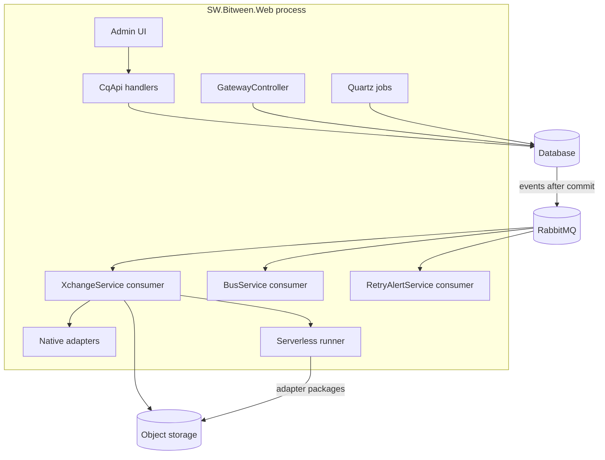

# Architecture

## One service

Bitween runs as a single ASP.NET Core process built from `SW.Bitween.Web`. Every replica does all of the following.

| Role | How |
|---|---|
| Serves the admin UI | Static files from `wwwroot`, falling back to `index.html` for client-side routes |
| Serves the REST API under `/api` | Handler classes in `SW.Bitween.Api/Resources`, exposed by the SimplyWorks CqApi library |
| Serves partner gateways | `GatewayController`, at `/api/gateway/{urlName}/sync` and `/async` |
| Serves Swagger UI and health | `/swagger`, with the spec at `/api/swagger.json`, and `/health` |
| Consumes RabbitMQ | Exchange processing, result notifications, bus front doors and alerts |
| Runs scheduled jobs | Quartz, with its job store in Bitween's own database |
| Holds data source connections | Resident adapters under a supervisor, on nodes with `Bitween:BusProvidersEnabled` |



## Projects

| Project | Role | References |
|---|---|---|
| `SW.Bitween.Web` | Host, startup wiring, authentication, headers, admin UI | Api, PgSql, MySql, MsSql, NativeAdapters |
| `SW.Bitween.Api` | Domain, `BitweenDbContext`, API handlers, pipeline, jobs, settings, the adapter editor's server side | NativeAdapters, Sdk, Adapters.Tooling |
| `SW.Bitween.NativeAdapters` | Built-in adapters and the rules-based mapper | none |
| `SW.Bitween.Sdk` | Request and response models, JSON converters, retry policy evaluator | none |
| `SW.Bitween.Adapters` | The Bitween adapter contract: its JSON in `Contract/` and its .NET form (`IBitweenHandler`, `IBitweenMapper`, `IBitweenValidator`, `IBitweenReceiver`, `ExchangeFile`, `ValidationResult`). Targets netstandard2.0 with no dependencies; published to NuGet as `SimplyWorks.Bitween.Adapters` | none |
| `SW.Bitween.Adapters.Tooling` | Bitween's adapters on SW-Serverless's tooling (`SimplyWorks.Serverless.Tooling`): the contract, the templates for the four kinds, and the Python and Node packages to vendor into builds, embedded from `SW.Bitween.Adapters/Contract` and `sdk/` | none |
| `SW.Bitween.Cli` | The `bitween` command. See [The bitween CLI](cli.md) | Adapters.Tooling |
| `SW.Bitween.PgSql`, `MySql`, `MsSql` | Provider contexts, migrations, design-time factories | Api |
| `SW.Bitween.Adapters.Bus.RabbitMq`, `Bus.Sqs` | Resident broker adapters | none |
| `SW.Bitween.Adapters.Db.Core`, `Db.PostgreSql`, `Db.MySql`, `Db.SqlServer`, `Db.Oracle` | Resident database adapters and their shared base | Db.Core |
| `SW.Bitween.Sample*` | Example custom adapters, including a resident handler | none |
| `SW.Bitween.UnitTests`, `IntegrationTests`, `HttpTests`, `TransportTests` | Test suites. See [Development](development.md#tests) | The projects they test; `HttpTests` hosts Web and runs the CLI |

Outside the solution, `sdk/python` is the Python package `simplyworks-bitween` and `sdk/node` the Node package `@simplyworks/bitween`: the four kinds for adapters in those languages, built on SW-Serverless's `sw-serverless` and `@simplyworks/sw-serverless`.

Bitween's own projects target .NET 10, the resident adapters included, except `SW.Bitween.Adapters`, which targets netstandard2.0 so that an adapter on any supported .NET can reference it. The resident adapters share their settings attributes from `SW.Bitween.Adapters.Shared` as linked source.

### SimplyWorks libraries

Much of the plumbing comes from Simplify9's `SimplyWorks.*` packages.

| Package | Provides |
|---|---|
| `SimplyWorks.CqApi` | Turns handler classes into HTTP endpoints, with Swagger |
| `SimplyWorks.Bus`, `SimplyWorks.Bus.RabbitMqExtensions` | RabbitMQ publish and consume, retry and dead-letter queues, management API readers |
| `SimplyWorks.CloudFiles.*` | Object storage for S3, Azure Blob, Oracle Cloud and local disk |
| `SimplyWorks.Serverless` | Downloads adapter packages and runs them, either as one process per call or as long-lived resident processes, on .NET, `python3` or `node` |
| `SimplyWorks.Serverless.Tooling` | Building, checking, running and publishing adapter packages: what `sw-serverless`, the `bitween` CLI and the adapter editor use |
| `SimplyWorks.Scheduler.*` | Quartz with a persistent job store per database provider, plus execution history |
| `SimplyWorks.EfCoreExtensions` | Startup migration, JSON columns, audit stamping |
| `SimplyWorks.Logger.*` | Console and Elasticsearch logging |
| `SimplyWorks.PrimitiveTypes` | Adapter interfaces, `XchangeFile`, request context, domain events |
| `SimplyWorks.HttpExtensions` | JWT helpers and the typed API client base |

## Data

Bitween keeps configuration and runtime records in one relational database, through Entity Framework Core 9.

- **Providers.** `Bitween:DatabaseType` selects PostgreSQL, SQL Server or MySQL. Each provider has its own context and migrations project. On PostgreSQL, tables live in the `infolink` schema and columns use snake_case.
- **Migrations** run automatically at startup, before the host starts serving.
- **Quartz tables** live in the same database.
- **Audit.** Saving a configuration entity writes audit rows in the same transaction. So does saving an adapter draft, a version published, promoted or withdrawn from Bitween, and each read of an adapter's source. Runtime rows such as exchanges are not audited. The synchronous `SaveChanges` throws, so no save can skip the audit.
- **Domain events** are published to RabbitMQ after the transaction commits.

| Area | Tables |
|---|---|
| Configuration | Documents, Partners, PartnerApiCredentials, Subscriptions, SubscriptionSchedules, SubscriptionCategories, WorkGroups, GlobalAdapterValuesSets, ApiGateways, ApiGatewayPartners, BusGateways, BusGatewayRoutes, RetryPolicies, RetryAlertOverrides, NotificationChannels, Notifiers, Settings, DataSources, DataSourceStatements |
| Runtime | Xchanges, XchangeResults, XchangePromotedProperties, XchangeAggregations, XchangeNotifications, OnHoldXchanges, DelayedRetries, RetryGroupUsages, ReceiveAttempts, InboundMessages, AdapterStates, ClusterLeases, ClusterNodes |
| Adapters | AdapterDrafts, AdapterReleases, AdapterSourceAccesses |
| Identity | Accounts, Roles, AccountRoles, RefreshTokens |
| Audit | AuditEntries |

## Messaging

RabbitMQ carries all asynchronous work. Queue names are lower-cased and built from the bus's process exchange, `Bitween:QueuePrefix`, the consumer class and the message name. The bus library adds a `.retry` and a `.bad` queue next to each one.

| Lane | Consumer | Message name | Carries |
|---|---|---|---|
| Work | `XchangeService` | `{workGroupId}{busMessageName}`, or `0Ungrouped` | Exchange ids to process |
| Notifications | `XchangeService` | The work lane's name plus `-Result` | Result ids for notifications |
| Front door | `BusService` | Each bus-enabled information type's message type name | Documents from other systems |
| Control | `XchangeService` | `SubscriptionUnpausedEvent` | Releasing on-hold exchanges |
| Control | `RetryAlertService` | `RetryBudgetExhaustedEvent` | Budget alerts |
| Legacy | `XchangeService` | `ApiXchangeCreatedEvent` and four similar names | Only when `Bitween:ConsumeLegacyEventMessages` is on |

Creating a work group or a bus-enabled information type asks every instance to refresh its consumers, so new queues are picked up without a restart. Queues left behind by deleted or renamed lanes appear on the Queue health page.

## Adapter runtimes and data sources

Every stage of the pipeline runs its adapter through one invoker, which asks three runtimes in turn.

| Runtime | Runs |
|---|---|
| Native | Adapters compiled into Bitween, in process |
| Resident | Long-lived adapter processes that keep a connection or pool open |
| Classic | Custom adapters as a new process for each call |

A data source is a broker or database connection held by a resident adapter. On nodes with `Bitween:BusProvidersEnabled`, a supervisor reconciles every 30 seconds: it takes leases, starts and restarts adapters, and writes their health back. Broker connections run on one node at a time, held through an exclusive queue on Bitween's RabbitMQ and fenced by a counter in `ClusterLeases`. Database pools run on every enabled node. See [Data sources](data-sources.md).

## Storage

Exchange files are written as private text objects under this key.

```
{prefix}/{exchangeId}/{input|output|response}
```

`{prefix}` is `Bitween:DocumentPrefix` as it was when the exchange was created, recorded on the exchange (`FilesPrefix`), so the setting can change without losing files already written. Exchanges from before that column use the prefix recorded the first time this version started, kept in the `Settings` table as `Bitween.LegacyDocumentPrefix`.

The default prefix is `temp30/Bitweendocs`. The storage libraries keep delete rules for `temp1/`, `temp7/`, `temp30/` and `temp365/` on the bucket, so the default keeps files for 30 days. They're read back through `ICloudFilesLifecycle` for the Settings page and to explain a missing file.

Every file is written, and storage is the record of every payload; the database holds none. Writes run beside the work they belong to, and the save of the exchange or result that names a file waits for its write, so a saved row always has its files. On the way through, a payload no larger than `Bitween:MessagePayloadMaxBytes` (256 KB) also travels with the bus message: the input with the exchange's created message, and the response with the signal to a waiting sync call. Those are copies for the trip, used instead of a storage read; a message without one, such as one the outbox publishes again, is served from storage.

Readers without a Bitween login get links Bitween serves itself: an aggregation's handler, a partner reading its exchange result, an API client reading the exchange list. A link is `{address}/api/files/{seal}/{storage key}`, where the address is the public address the chart sets from its host name, else the one the request came in on, else (a scheduled job) the instance's own, such as `http://localhost:8080`. The seal is an HMAC of the storage key with a key derived from `Token:Key`, so a link opens its own file and no other, and nothing is stored per link. Custom adapter packages live under `Bitween:AdapterPath`.

## Caching

Information types, active subscriptions, notification channels, legacy notifiers, work groups, global value sets and bus gateway routes are cached in memory for 10 minutes. Every change made through the API broadcasts a revoke over the bus, and each instance then drops its cache and reloads settings. If the broadcast fails, the change is still saved, but other instances can serve old values until their cache expires.

Inactive subscriptions are not cached, so no entry point can start them.

## Running more than one replica

Replicas share the database and RabbitMQ. Exchange processing scales out by adding replicas and tuning prefetch and parallel exchanges per work group. These points need care.

- Quartz runs clustered on every database provider: each replica gets its own scheduler instance id, and a fire is claimed through row locks in the Quartz tables, so each fire runs on one replica only. Which replica runs a job is up to Quartz, and one replica often runs them all. If it stops, another picks the jobs up within about 30 seconds, Quartz's idle wait; a replica that dies without stopping misses its 10-second check-ins, and about 20 seconds later the others release what it had claimed. Retry, retention, cleanup, pruning and queue snapshot jobs each have one schedule, run one at a time across the cluster, and need nothing more.
- Each schedule of a receiver or aggregation, and each **Receive now** or **Aggregate now**, is a separate Quartz job, so two runs of one subscription can overlap, on one replica or two. Both claim the subscription's database running flag first, and the second one skips.
- Settings and cache changes reach other replicas only through the bus broadcast.
- Data source adapters run only on replicas with `Bitween:BusProvidersEnabled`. A delivery through a data source fails on a replica without it.
