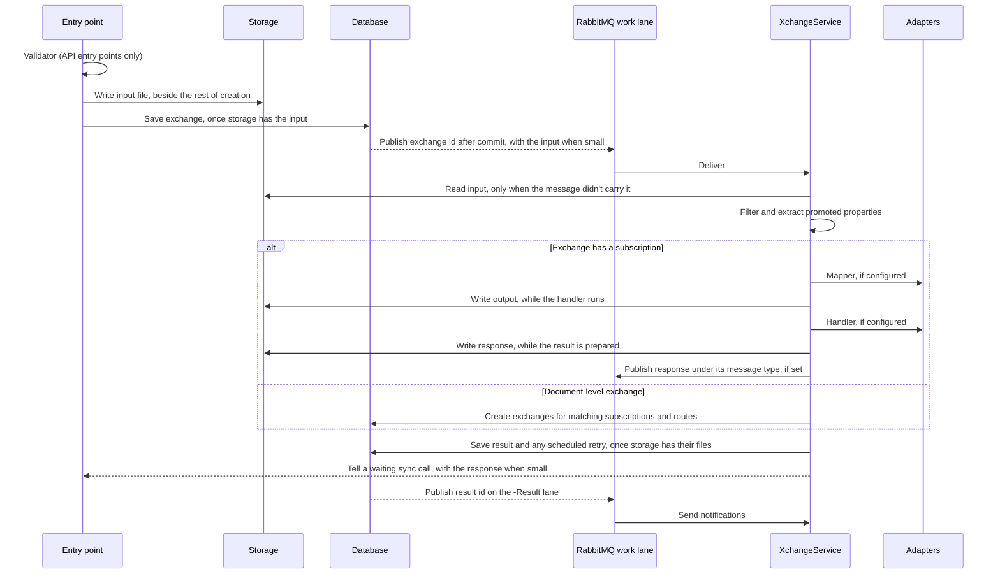

# Exchange pipeline

This page follows one message from arrival to result. [Entry points](entry-points.md) covers how each kind of message arrives.

## Overview



Every stage runs its adapter through the same invoker, whether the adapter is native, resident or classic. A stage bound to a [data source](data-sources.md) runs through that connection.

## 1. Creation

Every entry point ends the same way. The input's write to storage starts, the exchange row is added while it runs, and the save commits only once storage has the input, so a saved exchange always has its file. A write that fails fails the save. After the commit, an event goes to the lane of the subscription's work group. It carries the exchange id and, when the input is no larger than `Bitween:MessagePayloadMaxBytes` (256 KB), the input itself, so the worker doesn't read it back from storage. The outbox row keeps the id alone: a message the outbox publishes again later, after a failed publish, has no input, and the worker reads storage. Storage is written for every input either way and stays the record; the copy in the message is used only when it matches the hash stored on the exchange.

When an exchange is created for a subscription, Bitween resolves `{{partner.KEY}}` and `{{globals.SET.KEY}}` tokens in the mapper and handler properties and stores the result on the exchange. The partner is the one the entry point supplies, such as the calling partner or a bus gateway route's partner. Otherwise it is the subscription's own partner. Tokens that cannot be resolved are left as written.

Because properties are copied onto the exchange, later edits to the subscription do not affect exchanges that already exist. A retry with *re-resolve adapter properties* picks up the current configuration.

## 2. Validation

The validator runs only at two entry points: API gateways and the legacy `POST /api/xchanges/{informationType}` endpoint. It runs synchronously, before the exchange is created. A failed validation returns a validation error to the caller and stores nothing.

Scheduled jobs, bus messages, aggregations and exchanges created by hand never run a validator.

## 3. Filtering and promoted properties

Processing starts by reading the input in the information type's format.

- **JSON** payloads are read with JSON path expressions. Only a JSON object can be read, so a payload whose root is an array yields no promoted properties and matches no filter.
- **XML** payloads are read with XPath, after decoding HTML entities and removing characters XML does not allow. A payload that is not valid XML fails the exchange.

Promoted property values are stored as sent, up to 500 characters. A longer value is stored cut, ending in "…", and a warning naming the exchange and property is logged. Filters and routes read the payload itself, so they still see the whole value. Search compares the stored values ignoring case. Lists show them in the order the information type lists its properties, and the first one also names an exchange's archive file.

For a document-level exchange, the filter also decides where the document goes.

- Internal subscriptions of the information type match when their match expression passes, or always when they have none.
- Bus gateway routes of the information type match the same way, unless their gateway is deactivated.
- API gateway, bus gateway, scheduled job and legacy API call subscriptions are never matched by content. They only run through their own entry point.

### Match expressions

A match expression is a tree of conditions, stored as JSON.

```json
{
  "type": "and",
  "left":  { "type": "one_of",     "path": "order.country", "values": ["JO", "AE"] },
  "right": { "type": "not_one_of", "path": "order.status",  "values": ["cancelled"] }
}
```

| Type | Matches when |
|---|---|
| `one_of` | The value at `path` equals one of `values`, ignoring case |
| `not_one_of` | The value at `path` is missing or equals none of `values` |
| `and`, `or` | Both, or either, of `left` and `right` match |

Paths are read from the payload with the same reader as promoted properties. Older subscriptions may have a *document filter* instead, keyed by promoted property name with comma-separated values. Bitween turns each entry into a `one_of` condition and joins them with `and` at run time.

## 4. Mapping

When the exchange has a mapper, the mapper turns the input into the output file. It receives its properties plus an `xchangeid` entry.

How the mapper sees partner and global values depends on the mapper.

- The **rules-based mapper**, `NativeMapper`, receives partner and global values as separate context. The payload reaches it untouched, so it can map XML as well as JSON.
- **Every other mapper**, including the legacy JSON mapper and custom mappers, gets them written into the payload as `__partner__` and `__globals__` keys, and only when the payload is a JSON object. A payload that is not JSON fails the exchange before the mapper runs. A real payload key with either name is overwritten.

A mapper that returns nothing fails the exchange. See [Mapping](mapping.md).

## 5. Delivery

When the exchange has a handler, it receives the output file, or the input file when there is no mapper. It can return a response, which is stored as the response file. A handler can flag its response as bad data, as the HTTP handler does for 4xx replies.

An exchange with neither a mapper nor a handler simply succeeds.

A handler bound to a data source can publish to a customer's broker or run SQL against a database. See [External brokers](external-brokers.md#delivering-to-a-broker) and [Databases](databases.md#writing-with-a-handler).

## 6. Response routing

After the handler returns a response:

- When the subscription has a **response message type name**, the response is published to RabbitMQ under that name, unless it was flagged bad. Any bus-enabled information type with that message type name receives it as a new document, so the flow can continue through a bus gateway. The id of the exchange that delivered travels beside the body, in the `request-context-values` header, so a bus gateway route can read that exchange's input. The body itself is unchanged.
- When the subscription hands its response to a **response subscription**, a new exchange is created on that subscription with the response as its input and the same correlation id. It runs as the partner of the exchange that fed it, and only gets a bad response if *also run on a bad response* is on. Subscriptions saved before the Response type existed may still hand theirs to an Internal or API call subscription. Those get every response, run as their own partner, and get no source values.

A response subscription can also read **source values**: values from the **original document**, by path. The original document is the input of the exchange whose delivery got the response. For example, a carrier's reply has a tracking number but not the order number, and `{{source.order.number}}` reads it from the order. So can a bus gateway route's subscription, when its message was published as a delivery's response.

- The original document is always that exchange's input, as it arrived, never what its mapper made of it. So a path follows the information type's shape, works whichever subscription of that type fed the response, and survives a change to that subscription's mapping. It is read as JSON, or as XML when it starts with `<`. Paths work the way mapping paths do: dot-separated, matched exactly, never into a list. An XML path starts with the root element.
- The values are read when the exchange is created, and only the paths the subscription uses are kept, on the exchange. A retry or a release from pause uses the same values, even after the delivering exchange is archived, so the original document is never read again. The exchange also keeps the id of the delivering exchange, and its drawer links to it.
- In the handler's properties, `{{source.PATH}}` is filled when the exchange is created. A path with no value is left as written, and the exchange then fails before its mapper runs, naming the path. It never sends the token's text on. A bus gateway subscription using one fails the same way on a message published any other way, such as by another product, or by another Bitween on the same bus.
- In a rules-based mapping, a value of kind `source` reads one. A path with no value gives null, as any mapping path does. See [Mapping](mapping.md#field-rules).
- Mapper properties are not filled, so a JSON mapping stays valid whatever a value contains.

Any path can be saved. The editor offers the paths in the last document each feeding subscription received, with the value it had as an example, and warns about a path that document didn't have. It doesn't refuse it: documents vary, and the next one may have it. A response subscription is fed by every subscription that hands it its response. A bus gateway subscription is fed by every subscription whose response message type name is its information type's bus message type name, ignoring case.

A subscription cannot route its response into itself, into anything but a response subscription, or round a loop of them.

## 7. Result

Bitween saves the result.

- After a success, any retry budget of the subscription that was exhausted before this exchange started is released.
- After a bad response or an exception, the retry policy is evaluated and may schedule a delayed retry. See [Retries and alerts](retries-and-alerts.md).

Retry evaluation can never cost the result. If evaluation itself fails, the error is logged and the result is still saved.

The output and response files are written while the handler runs and the result is prepared, and the result is saved only once storage has them. When a write fails the exchange fails, and the failure result names only the files that were written.

When a [sync gateway call](entry-points.md#async-and-sync) waits for the exchange, the worker tells it as soon as the result is saved, on success and on failure. On the node holding the call it does so directly; otherwise it broadcasts to every node, and the one holding the call takes it. The signal carries what the answer needs, including the response when it is no larger than `Bitween:MessagePayloadMaxBytes` (always, on the same node), so a successful call is answered without reading the database or storage.

## 8. Notifications

Saving the result publishes its id on the work group's `-Result` lane. There, each of the subscription's notifications whose outcome matches sends through its channel, and so does each active legacy notifier watching the subscription. See [Subscription notifications](retries-and-alerts.md#subscription-notifications).

## Pausing

While a subscription is paused, messages that reach it by content are stored as on-hold exchanges. That covers documents matched to internal subscriptions and bus gateway routes. Resuming the subscription publishes an event that turns every on-hold exchange into a real exchange and deletes the holds.

API gateway calls, legacy API calls, scheduled job runs, aggregations and exchanges created by hand ignore the pause and still create exchanges.

## Aggregation

An aggregation subscription runs on a schedule. Each run does the following.

1. Selects up to 10,000 successful exchanges of the source subscription that have not been aggregated yet.
2. Builds a JSON array holding a link to one file of each exchange: input, output or response, as configured.
3. Creates one exchange on the aggregation subscription with that array as its input, and links each source exchange to it.

The new exchange then runs through the normal pipeline, so the aggregation's own mapper and handler process the list. The links are served by Bitween and open without a login, so whatever processes the list can download each file. They're built on the public address the chart sets from its host name, so a partner handed the list can open them. Without one they use the instance's own address (`http://localhost:8080` in the container), which adapters running in Bitween can open but nothing outside it can. With neither address, the run fails instead of listing links nothing can open. A roll-up made by an earlier version lists storage URLs instead; retrying it swaps them for Bitween links.

The first run of a new aggregation collects everything the source subscription has ever produced. The UI therefore creates aggregations disabled by default.

Retention doesn't wait for aggregations: an exchange removed before an aggregation runs is never rolled up. An aggregation whose schedule can wait longer between runs than **Keep exchanges (days)** shows a warning under its schedule, and the Settings page names it when retention is changed.

## Files and URLs

Exchange lists return a link and a storage key for each file that has content. The link is served by Bitween, see [Architecture](architecture.md#storage). The UI reads file content through `GET /api/bitweendocs?documentKey=...`, which needs `exchanges.view`.

## Limits

| Limit | Value |
|---|---|
| Request body size | 50 MB |
| Exchanges counted by one search | 10,000 |
| Exchanges collected per aggregation run | 10,000 |
| Exchanges buffered per lane per node | The work group's prefetch, 12 by default |
| Concurrent exchanges per lane per node | The work group's parallel exchanges, capped by its prefetch; empty takes the prefetch. The Ungrouped lane takes `Bitween:BusDefaultConcurrency`. A results lane runs one at a time |
